<div align="center">

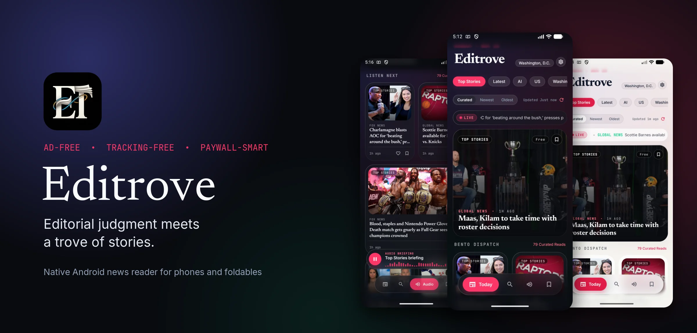

<br>

[](https://github.com/mgmourad/Editrove/releases)
[](LICENSE)
[](#install)
[](#under-the-hood)

**No ads. No tracking. No accounts. No paywall dead ends.**

A fast, beautiful news reader for Android phones and foldables. It weaves Google News with
**117 hand-picked publisher feeds** and routes every story around its paywall.

[**Download the latest APK →**](https://github.com/mgmourad/Editrove/releases/latest) &nbsp;·&nbsp; [Features](#what-makes-it-different) &nbsp;·&nbsp; [Screenshots](#a-closer-look) &nbsp;·&nbsp; [Build](#build-it-yourself)

</div>

---

## What makes it different

<table>
<tr>
<td width="50%" valign="top">

### 🔓 Reads past paywalls
Every publisher is classified by its paywall. Open stories open directly; metered ones go
through a reader service (smry.ai, RemovePaywall, UnWall, Freedium); hard paywalls fall
back to **archive.today** or the **Wayback Machine**. If no readable copy exists, the
headline is greyed out and **locked**. If a service goes down, Editrove **falls back to the
next one** automatically.

</td>
<td width="50%" valign="top">

### 📰 An editor's front page
A Liquid Glass interface in **Black Glass** and **Editorial Paper**, with Newsreader
serif headlines. Each feed has a live ticker, a full-bleed cover story and a Bento grid. Stories
open in a reader with the publisher's standfirst, a drop cap, a pull quote and an
**on-device summary**.

</td>
</tr>
<tr>
<td valign="top">

### 🎧 A briefing that sounds like the news
Audio briefings play like a broadcast: an opening cue that sinks under the anchor, dated
open, hand-offs and transition stings between stories, and a sign-off. Choose **Headlines**
(each headline and its subtitle), **Summaries** (plus the key points from the story's Summary
box) or **Full articles**, the number of stories, the voice and the speed, and schedule a **Morning, Afternoon and Evening briefing** that plays at the tap of a notification. A **floating
mini-player** follows you down the page.

</td>
<td valign="top">

### 📱 Built for foldables
A cover-screen layout with a floating nav pill and slide-up reader. When unfolded, choose **Split
view** (feed and story side by side) or **Full view**: a magazine-style canvas where
stories open as full pages. Swipe between Today, Discover, Audio and Saved.

</td>
</tr>
<tr>
<td valign="top">

### 🧭 Your edition, your topics
Any city in 18 countries drives your national and local topics, read live from Google News
in the right language. Hide and reorder topics, build your own from keywords or sources,
and add any RSS/Atom feed.

</td>
<td valign="top">

### 🔒 Private by design
No analytics, no ads, no accounts and no server of its own. Settings, saved stories
and notifications all live on your device. Updates arrive straight from GitHub Releases,
**checked against their published SHA-256** before they install.

</td>
</tr>
</table>

## A closer look

<p align="center"><b>On your phone</b> — Today · Reader · Audio · Editorial Paper</p>

<p align="center">
  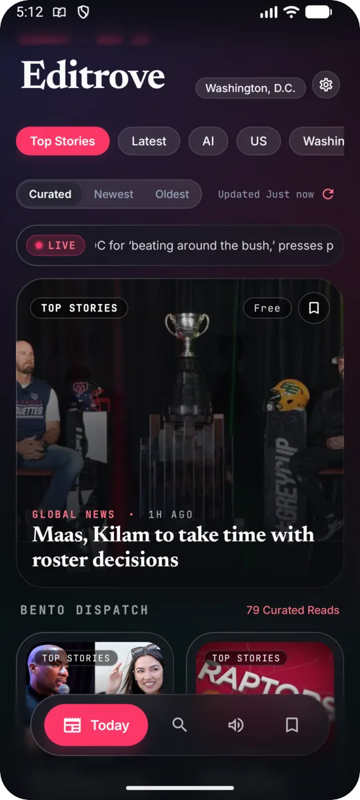
  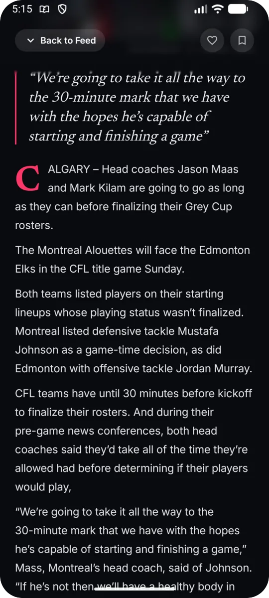
  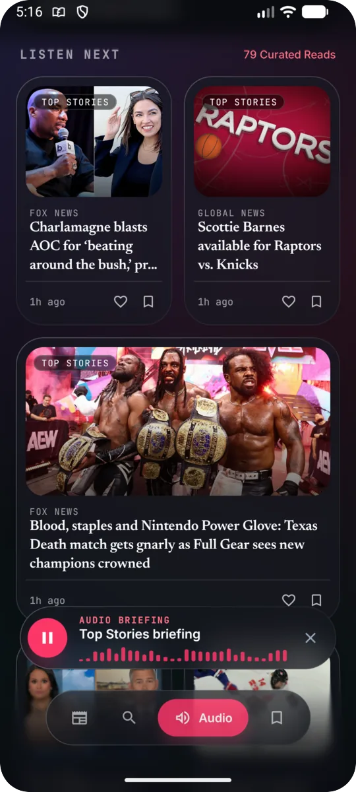
  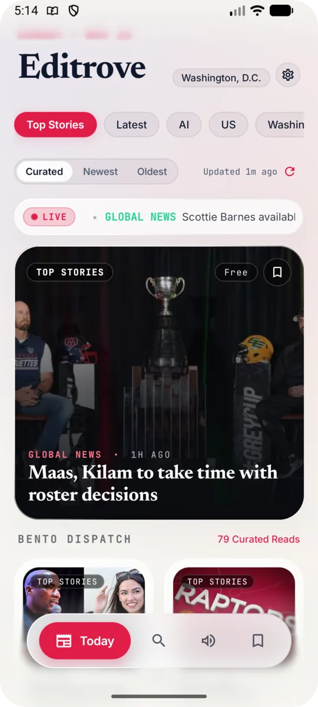
</p>

<p align="center"><b>Unfolded</b> — Full view, a magazine for your foldable or tablet</p>

<p align="center">
  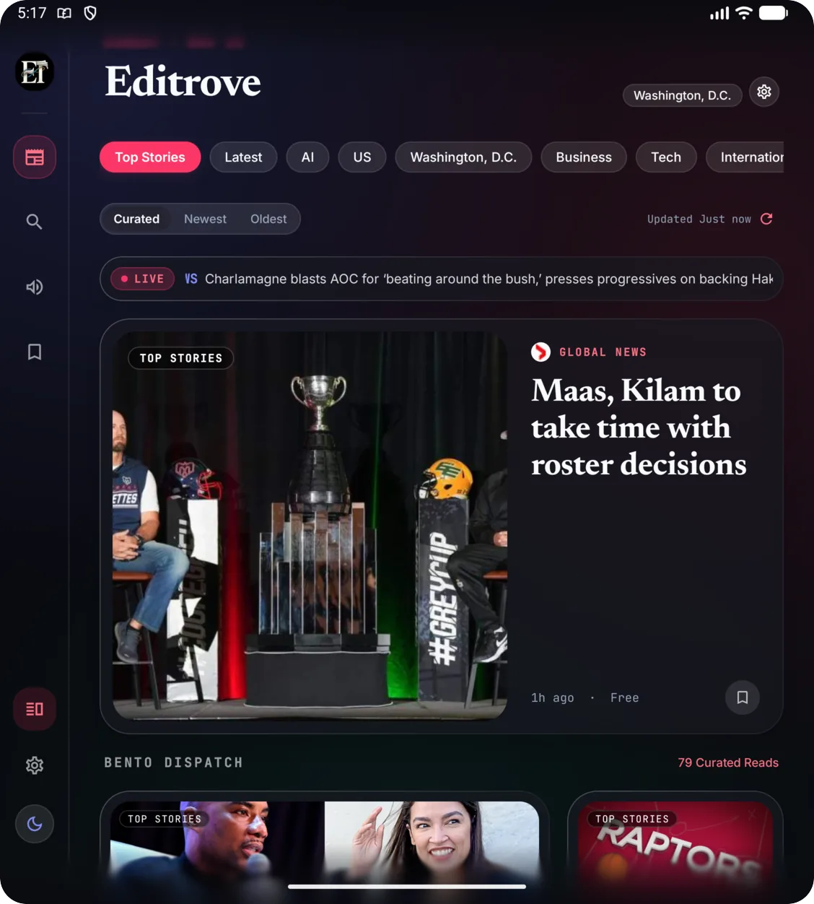
  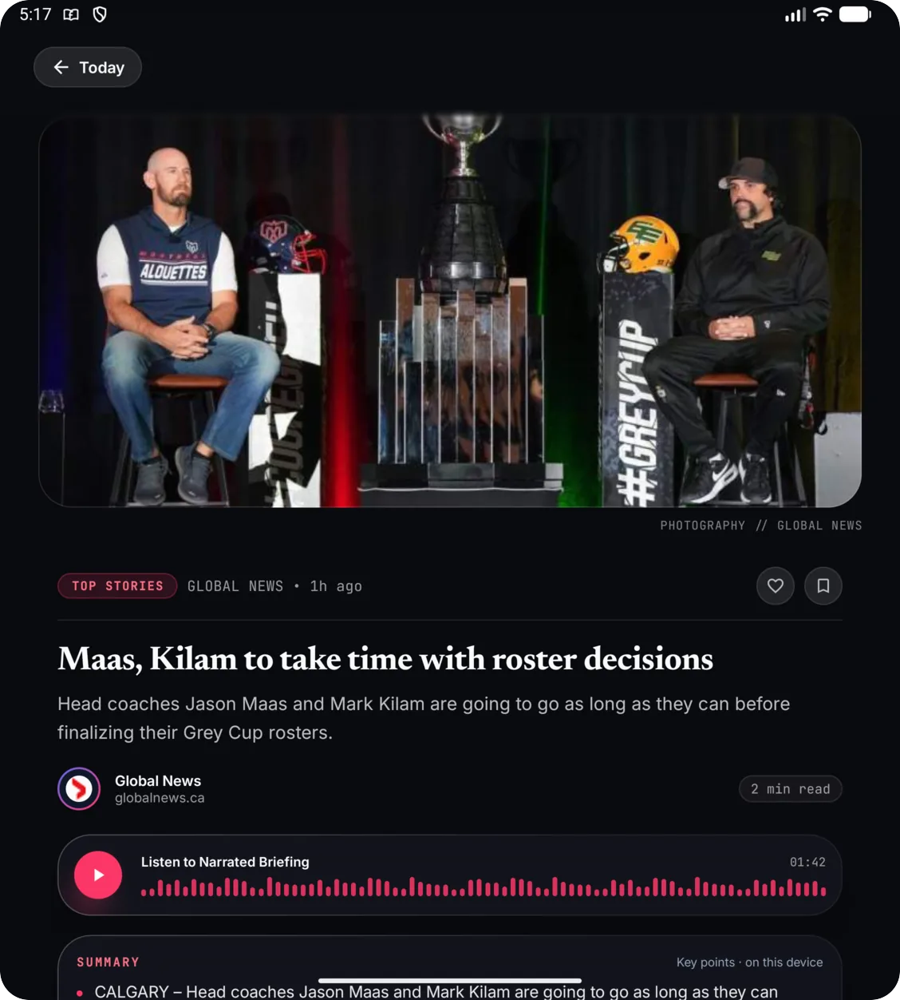
</p>

<p align="center"><b>Split view</b> and <b>Editorial Paper</b> when unfolded</p>

<p align="center">
  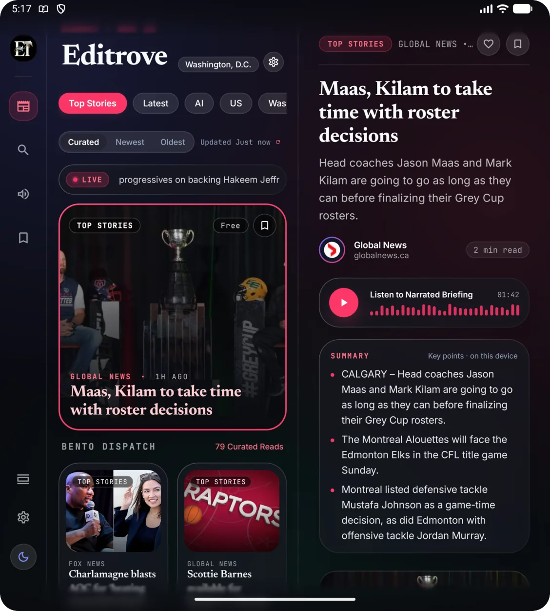
  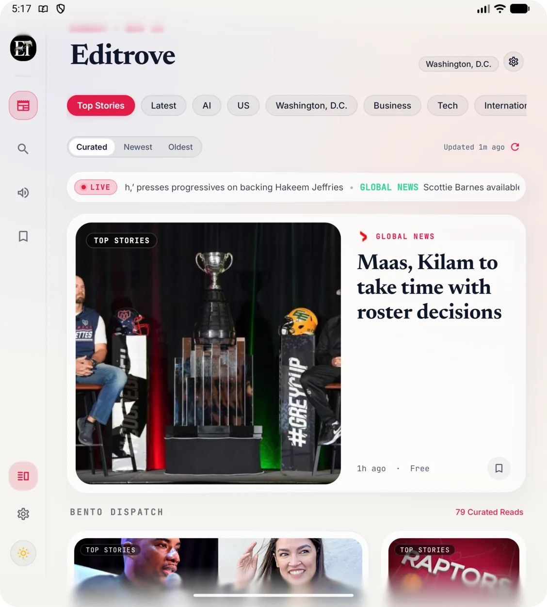
</p>

<p align="center"><b>On your home screen</b> — the Daily Brief widget</p>

<p align="center">
  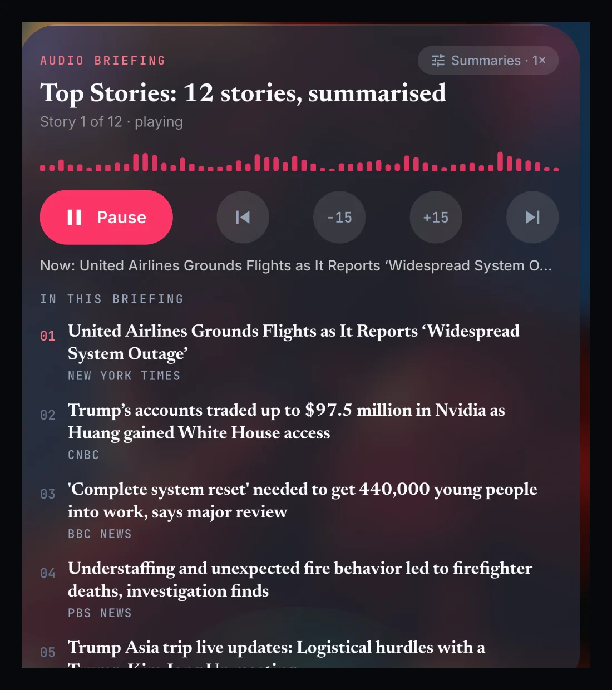
</p>

<p align="center"><b>Out of your way</b> — what's new after each update · every setting in one place</p>

<p align="center">
  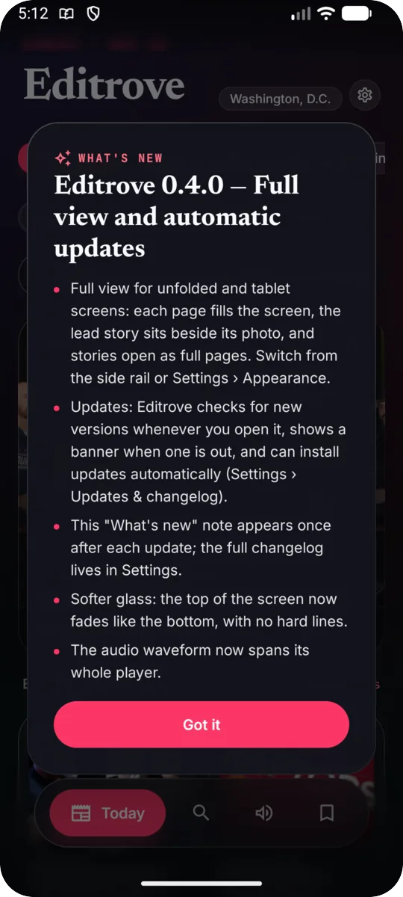
  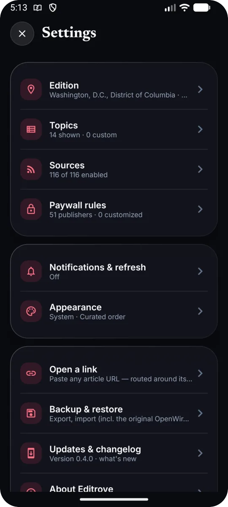
</p>

## Everything it does

| | |
|---|---|
| **Topics** | Top Stories, Latest, AI, your country, your city, Business, Tech, International, Science, Entertainment, Sports, Politics, Finance, Lifestyle, plus your own keyword and source topics |
| **Sources** | 117 feeds, including the Washington Post, NBC, CBS, BBC, NPR, Axios, The Economist, The Atlantic, Bloomberg, WSJ, ESPN, MIT Technology Review, NASA and more. Each gets a fair share; 2 stories from one outlet in a row at most |
| **Paywall engine** | Per-publisher strategies with an editable rules list; archive checks with grey-out; a reader-service health check and fallback chain |
| **Reading** | In-app reader with on-device summary, narration, pull quotes and drop caps; text from the publisher, then Wayback, then archive.today |
| **Widgets** | **The Editrove Daily Brief**: the app's Audio Briefing card on your home screen, in the app's own fonts, with play/pause, ±15 s, previous/next story, speed and a live waveform. **Top Stories** and **Topic of Choice** (the one topic you pick, with a refresh button) show photos, sections and bookmarks. They resize from 2×2 to an unfolded 6×3 |
| **Open anything** | Share a link from any app, select a URL and pick *Open in Editrove*, or paste one. It's routed and opened in the reader |
| **Smart curation** | An on-device editorial ranker: where editors placed a story, how many outlets cover it, freshness, source authority and section fit (hard news leads the front page), then de-duplicated and diversified. "Also covered by" shows who else is running a story, and an optional, local-only tuning favours outlets you save and like. Applies to every topic, Discover and the audio briefing |
| **Market watch** | On the Business tab, a MARKETS bar with major indexes, yields, oil, gold, EUR/USD and Bitcoin; tap for a popup with prices, day ranges and sparklines (Yahoo Finance, may be delayed) |
| **Breaking news** | Optional heads-up alerts when newsrooms you pick (AP, Reuters, BBC, CNN and more) break a story, or when three or more outlets publish the same story within half an hour. Separate from topic alerts |
| **Stay current** | Opening the app or switching pages quietly refreshes anything older than a few minutes; background refresh every 15 minutes to 6 hours (your choice); pull to refresh; opt-in local notifications per topic, grouped into one bundle so several updates arrive with a single sound |
| **Sharing** | Every card and the reader have a share button that sends the headline first, then the publisher's own link (never a Google redirect) |
| **On-device feeds** | Built-in topics are built on your phone from live newsroom feeds and ranked on the device, so stories are minutes old. The published snapshot is only a first paint and a fallback |
| **Updates** | Checks GitHub Releases on launch, shows an in-app banner, optional automatic install, a "What's new" note and a full changelog in Settings |
| **Portability** | Export and import every setting as one JSON file, including backups from the original OpenWire web app |

## Install

1. Download **`Editrove-<version>.apk`** from the [latest release](https://github.com/mgmourad/Editrove/releases/latest).
2. Optionally verify it: the SHA-256 is listed in the release notes.
3. Open it and allow your browser or file manager to install apps.

From then on Editrove keeps itself current: **Settings › Updates & changelog** lets you
check manually or turn on automatic installs.

> Android 8.0+ · works on phones, foldables and tablets · no Google Play Services required

## Build it yourself

```bash
./gradlew assembleDebug        # debug APK
./gradlew test                 # 105 JVM unit tests (domain, data, ViewModels)
./gradlew lintDebug            # Android lint
./gradlew assembleRelease      # signed release (see below)
```

- **Release signing:** reads `signing/keystore.properties` or `~/.openwire/keystore.properties` (`storeFile`, `storePassword`, `keyAlias`, `keyPassword`). Nothing secret is committed.
- **Snapshot host:** `-Popenwire.dataUrl=https://…/` points the app at your own copy of the published feeds.
- **Store builds:** `-Popenwire.selfUpdate=false` removes self-updating (e.g. for F-Droid).

## Under the hood

Kotlin · Jetpack Compose · Material 3 · [Haze](https://github.com/chrisbanes/haze) (glass blur) ·
Room · OkHttp · kotlinx.serialization · Coil · Jsoup · WorkManager · on-device TextToSpeech.

```
app/            Compose UI, navigation, theme, updater, DI wiring
data/           Repositories, Room cache, feeds, settings, archive and image lookups
domain/         Pure Kotlin: paywall engine, feed weaver, topics, sources, codecs
notifications/  WorkManager background refresh + local notifications
```

See [`SPEC.md`](SPEC.md), [`ARCHITECTURE.md`](ARCHITECTURE.md), [`adr/`](adr/) and
[`CONTRIBUTING.md`](CONTRIBUTING.md) for the details, and [`SECURITY.md`](SECURITY.md) to report a
vulnerability.

## Credits

Editrove began as a fork of the original **OpenWire** web app by **Anson Lai**. Its paywall
engine, source catalog and feed pipeline are ported from that project and built on here. Typefaces:
Newsreader, Inter and JetBrains Mono (SIL Open Font License). Briefing opening cues and the
transition sting are royalty-free music from [Fesliyan Studios](https://www.fesliyanstudios.com/royalty-free-music/downloads-c/breaking-news-intro-music/26) and [Pixabay](https://pixabay.com/music/) (cues 5–11).

The legacy web app (`index.html`, `css/`, `js/`) and the scheduled feed pipeline
(`sync_news.py`, GitHub Actions) remain in this repository. The pipeline publishes topic
snapshots the app uses only as a first paint and offline fallback; feeds are built on the device.

## License

Free software under the **GNU Affero General Public License v3.0**. See [`LICENSE`](LICENSE).
